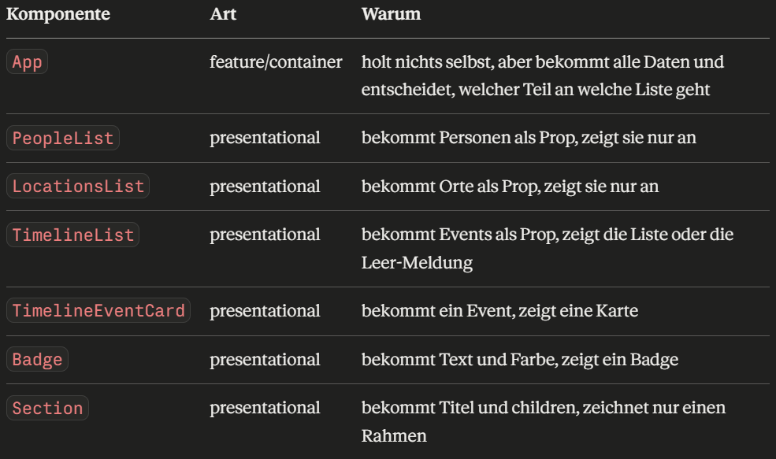

# Exercise 4 — React UI & Component Design

This is the fourth exercise in Advanced Web Engineering Course (CSDC). It builds on Exercise 3. This exercise migrates **two more views — People & Locations, and Timeline** — bringing the running total to 3 of the app's 5 views fully in React. **Evidence Catalogue and Workspace are deliberately not part of this exercise**. They need real interactivity (`useState`, controlled forms, a reducer) to make sense, and that's Exercise 5.

**This exercise is about structure, not behavior.** Migrate these views as presentational-first, e.g.
reusable components, typed props, lists and conditional content, and (for Timeline) filter controls that are visually complete but not required to be functionally wired to `onChange` handlers yet. "No state management beyond what is necessary to render the initial view" is the rule. It's fine (expected, even) for Timeline's filter dropdowns to not filter anything yet when changed by the user.

**Hard rules for every component you write in this exercise:**

- [ ] No `innerHTML`.
- [ ] No manual DOM creation (`document.createElement`, `.appendChild`, etc.).
- [ ] No state beyond what's needed to render the initial view (reading a query param once to decide _what_ to show initially is fine.

**Out of scope for this exercise**: Evidence Catalogue, Workspace, `useState` and any interactivity beyond what's needed to render the initial view, forms that actually submit
or validate anything, global/shared state, and accessibility (not covered in this course).

## Corresponding manuscript reading

This exercise corresponds to the following chapters in the course manuscript:

- **Chapter 15, React Foundations** — “JSX is JavaScript syntax for UI descriptions” through “The component tree,” PDF pp. 104–106
- **Chapter 16, React Component Design and Routing** — all sections, PDF pp. 110–114

## Self-Check

The exercise is organized into 10 individual tasks with corresponding questions, that are presented in class.

These checkboxes are for self-checking. Don't forget to do the actual checking of tasks you are able to present in the Moodle course. **Before class, tick only what you can genuinely demonstrate or answer on the spot, live.**

| #   | Demo                                                           | Ready? |
| --- | -------------------------------------------------------------- | ------ |
| 1   | JSX, function components, typed props, composition & children  | ☐      |
| 2   | Conditional rendering                                          | ☐      |
| 3   | Rendering collections                                          | ☐      |
| 4   | Stable keys and list identity                                  | ☐      |
| 5   | Presentational vs. feature components and component boundaries | ☐      |
| 6   | Feature-oriented folder structure                              | ☐      |
| 7   | Reusable UI elements                                           | ☐      |
| 8   | Routing: People & Locations as real routes                     | ☐      |
| 9   | Route parameters                                               | ☐      |
| 10  | Query parameters as URL state + migration wrap-up              | ☐      |

---

## Demo 1 — JSX, function components, typed props, composition & children

**Tasks**

- [ ] Build at least 3 small components for the People & Locations or Timeline views using JSX,
      each with an explicitly typed props interface/type (no untyped or `any` props).

  I built five components for these views: PeopleList, LocationsList, TimelineList, Badge and Section. Each one has its own props type at the top, so there's no any anywhere. The list components get the data as an array of my existing types from types.ts, like Person or TimelineEvent.

- [ ] Build at least one component that takes `children` (composition) rather than a data prop, and use it in a real place in the app (e.g. a generic card/panel wrapper).

  Section is a wrapper that takes children. It puts a heading on top and wraps whatever is inside in a section element. In App I use it three times: once around the people list, once around the locations and once around the timeline. Whatever I write between the opening and the closing Section tag becomes its children.

**Questions** (depend on the tasks above)

- [ ] Show one JSX expression in your code that embeds a JavaScript value or expression (not just static markup). For example `{person.name}` or a computed value. What can and can't go inside `{...}` in JSX?

  For example person.name, or in the timeline new Date of the event time, which is computed. Inside the curly braces you can put any JavaScript expression, so anything that produces a value: a variable, a function call, a ternary, or a map that returns elements. What you can't put there are statements, like an if, a for loop or a variable declaration, because they don't produce a value.

- [ ] For one component's typed props: what would TypeScript catch if you passed the wrong shape of data to it? Demonstrate a real type error by passing something wrong on purpose.

  PeopleList expects an array of Person. If I pass the locations instead, TypeScript shows an error right away: a Location is missing role, speciality, responsibilities and so on. So I find the mistake in the editor, before I even open the browser. Without types, the page would just show empty or broken cards.

- [ ] What's the difference between passing data as a named prop versus passing it as `children`? Why did you choose `children` for the component you built with it?

  With a named prop, I pass data and the component decides how to show it, like PeopleList gets the people and builds the cards. With children, I pass finished JSX, and the component only puts a frame around it. I chose children for Section because it doesn't care what's inside. It wraps a people list, a locations list or a timeline, and it works the same for all of them.

- [ ] Why does direct DOM manipulation (as the old vanilla `app.js` did constantly, e.g. `innerHTML`, `classList.add/remove`, manually building elements) conflict with React's rendering model? What assumption does React make about who "owns" the DOM that direct manipulation breaks?

  React assumes it owns the DOM inside its root. It remembers what it rendered last time and only compares its own descriptions, not the real DOM. If my code changes the DOM directly, with innerHTML or classList, React doesn't know about it. On the next render it either overwrites my change, or it works with a wrong picture of what's on the page, and things get out of sync. That's why in React the UI should only change through state and props.

---

## Demo 2 — Conditional rendering

**Tasks**

- [ ] Implement at least two real conditional-rendering cases in the views you're migrating. For example: an empty state (e.g. "no timeline events match" if applicable), and a state-dependent style/label (e.g. the active People/Locations tab, or a certainty badge's variant on a timeline event).
- [ ] Use at least two different conditional-rendering techniques (e.g. a ternary, `&&`, early-return, or a lookup/mapping function) and be ready to justify which you used where.

  Early return when the whole output is different, like an empty list. && for one optional piece, like the people line. And a lookup function for the badge, because there are more than two cases, so a ternary would get messy.

**Questions** (depend on the tasks above)

- [ ] Show one place where you used `condition && <Component />}` instead of a ternary. What would go wrong if `condition` were a number like `0` instead of a boolean and does that risk apply to your actual code?

  Here I use && for the people line. If the left side were a number like 0, React wouldn’t hide it, it would render the 0 as text. And yes, that risk applies to my code: personIds.length is a number, and three events have no people. That’s why I wrote length > 0, which is a real boolean.
  (dann live 0 zeigen)

- [ ] Why might returning `null` from a component be preferable to returning an empty `
` in some cases? Did you use either, and why?

  Returning null renders nothing at all. An empty div still adds a DOM node, which can mess with the layout, for example spacing in a grid, and it has no meaning. I didn’t need null here: for an empty list I return a message, because the user should know there’s nothing to show. I’d use null for a component that should simply not appear.

---

## Demo 3 — Rendering collections

**Tasks**

- [ ] Render the people list, the locations list, and the timeline events list, each as a mapped collection of components, each with a proper `key` prop.

**Questions** (depend on the tasks above)

- [ ] What does React actually use `key` for internally?

  React uses the key to match the items of the old list with the items of the new list after an update. So it knows which item is which, even when items are added, removed or reordered, and it only changes what actually changed in the DOM

---

## Demo 4 — Stable keys and list identity

**Tasks**

- [ ] Deliberately use `key={index}` in one throwaway example, then demonstrate (e.g. by reordering or filtering the underlying array) a case where it produces a visibly wrong result, before replacing it with a real stable id.

**Questions** (depend on the tasks above)

- [ ] What goes wrong, concretely, when keys are missing, duplicated, or based on array index for a list that can reorder or filter?

  With index keys, React matches items by position, so after reordering or filtering, things like typed input end up on the wrong item.

  Without keys, React warns and falls back to the position, so it’s the same problem.

  With duplicate keys, React can’t tell two items apart, so items can disappear, show up twice or get mixed up.

- [ ] The _original_ vanilla version of this app had a real bug where one feature used an array index as an identifier instead of a stable id. Would that same mistake, ported directly into React as `key={index}`, have caused a symptom a user could notice, or only a console warning? Explain why.

  Probably no visible symptom, and not even a console warning. The notes list only shows text from the data, so React still renders the right text. React only warns about missing or duplicate keys. It would become a visible bug as soon as every note had its own input or state and the list changed, exactly like in my demo.

- [ ] All of this app's real data (people, locations, timeline events) already has stable ids. Is there ever a legitimate reason to use `key={index}` anyway? When?

  Only when the list is truly static: nothing is ever added, removed, reordered or filtered, and the items have no state. For example the responsibilities list of a person. But even then, if there’s a stable id, I’d rather use it

---

## Demo 5 — Presentational vs. feature components and component boundaries

**Tasks**

- [ ] Classify every component you've built so far as either "presentational" or "feature/container". Explain why.

  
  App is my feature or container component: it gets all the data from main.tsx and decides which part goes to which list. All the others are presentational. They get everything they need through props and only render it. None of them knows where the data comes from. They would work the same with test data.

- [ ] Find at least one component that's currently doing more than one job, and split it into two components with a clear boundary between them.

  TimelineList used to do two jobs: handling the list, and building the markup of every single event. I split it. TimelineList now only handles the list: the empty state, and one TimelineEventCard per event. TimelineEventCard only knows how one event looks. The only thing that connects them is the event prop.

  1. Vorher (erzählen): TimelineList hat die Liste gemacht und das komplette HTML jeder einzelnen Event-Karte.

  2. Jetzt: TimelineList.tsx macht nur noch die Liste: Leer-Meldung und ein <TimelineEventCard /> pro Event, mit dem key.

  3. TimelineEventCard.tsx macht eine einzelne Karte: Datum, Badge, Titel, Beschreibung, People-Zeile.

**Questions** (depend on the tasks above)

- [ ] For the component you split: what was the single responsibility of each half after the split? If an implementation detail in one half changed, would that change affect the other half? Why or why not?

  TimelineList is responsible for the list: is it empty, and which events are shown in which order. TimelineEventCard is responsible for how one event looks. If I change the card, for example the badge or the layout, TimelineList doesn't change at all. And if I change the empty message or later add sorting, the card doesn't care. They only talk through one prop, the event, so as long as that stays the same, each half can change on its own.

- [ ] Give one concrete rule you used to decide "this belongs in a presentational component" versus "this belongs in a feature component."

  My rule: if a component only needs its props to render, and doesn't need to know where the data comes from or what the rest of the app is doing, it's presentational. As soon as it has to get the data, pick the right part of it or decide what should be shown, it's a feature component. In my app that's App, it gets the data and passes the right part to each list.

---

## Demo 6 — Feature-oriented folder structure

**Tasks**

- [ ] Reorganize your React source into a feature-oriented structure (e.g. grouping by
      `people-locations/`, `timeline/`, `dashboard/`, shared `components/`, rather than one flat
      folder of files). Including the Dashboard and shell from Exercise 3.

  My React code is organised by feature. Every view has its own folder: dashboard, people-locations and timeline, with everything that only that view needs. Shared components like Badge and Section are in components, and the shell, so the header and the not-found page, is in its own folder. Evidence and workspace will get their own folders when I migrate them in Exercise 5.

  zeigen:
  - dashboard/, people-locations/, timeline/: ein Ordner pro View, mit allem, was nur diese View braucht.
  - components/: was mehrere Views benutzen (Badge, Section, PlaceholderPage).
  - shell/: der Rahmen der App (Header, NotFoundPage).
  - direkt in src/: main.tsx, App.tsx, data.ts

- [ ] Document the structure you landed on (a short `ARCHITECTURE.md` section or README snippet is enough) and the rule you used to decide what's "shared" versus "feature-local."

  I documented it in ARCHITECTURE.md: the folder tree, the rule for shared versus feature-local, and a table of all routes. The rule is simple: a component stays in its feature folder as long as only that feature uses it. As soon as a second feature needs it, it moves to components.

  zeigen:
  ARCHITECTURE.md öffnen (Strg+Shift+V für die Vorschau): die Ordnerübersicht, die Regel „shared oder feature-local", die Namensregel für ...Page-Komponenten und die Routing-Tabelle.

**Questions** (depend on the tasks above)

- [ ] What's the difference between organizing files "by type" (all components in one folder, all hooks in another) and "by feature"? What made you choose the structure you chose for this app specifically?

  By type means one folder for all components, one for all hooks, one for all helpers. By feature means everything that belongs to one view is in one folder. I chose by feature because this app has five clearly separated views, and when I work on the timeline, everything I need is in the timeline folder, instead of picking files out of one big components folder. It also makes the next migrations easier: evidence and workspace just get their own folders.

- [ ] Where did you draw the line between a component that lives inside one feature folder and one that belongs in a shared/common folder? Give one real example of each from your own structure.

  The line is: is it used by more than one feature? TimelineEventCard is only used by the timeline, so it stays in the timeline folder. Badge is used by the timeline, the locations and the dashboard, so it's in components. I don't move something to components just because it could be reused one day, only when a second feature really uses it

---

## Demo 7 — Reusable UI elements

**Tasks**

- [ ] Extract at least one presentational component that is genuinely reused in **two or more different places** in the app (e.g. a badge, a card shell, a button variant), with a typed props API that makes it flexible enough for both uses without becoming a special-cased mess.

  I extracted a Badge component. It's used in two different places: the certainty badge on every timeline event, and the id badge on every location card. It has two typed props: the label, and the variant, which is the colour. The variant can only be one of the colours that exist in the CSS, so TypeScript rejects a colour that doesn't exist. The component lives in a shared components folder, because it doesn't belong to one feature.

**Questions** (depend on the tasks above)

- [ ] Show the two (or more) places your reusable component is used. What varies between them via props, and what stays fixed inside the component itself? How did you decide where that line goes?

  In the timeline, the label is the certainty and the colour depends on it. In the locations, the label is the location id and the colour is always blue. So the text and the colour vary through props. What stays fixed is the span element and the base class badge, so the shape and size are always the same. My rule was: everything that's different between the two uses becomes a prop, everything that should look the same everywhere stays inside the component.

- [ ] The original vanilla app had duplicated HTML-template code (the same card markup written out twice, slightly differently, in two functions). Compare that directly to what you just built. What does a reusable component give you that copy-pasted template strings didn't?

  In the old app.js, the badge markup is written out six times as a string, and not even in the same way: in one place the helper returns 'badge-reviewed', in another just 'reviewed'. If you wanted to change how a badge looks, you'd have to find and fix every copy, and it's easy to miss one. With a component there's one definition. Every use goes through the same props, TypeScript checks them, and a change in Badge.tsx changes every badge in the app at once.

  (Zeigen (optional): app.js, Strg+F nach class="badge. Es kommt sechsmal vor, in zwei verschiedenen Schreibweisen: im Dashboard ', darin <Header /> und <Routes> mit einer <Route> pro View: /dashboard, /evidence, /team/people, /team/locations, /timeline, /workspace, und * für alles andere.
  3. src/shell/Header.tsx: die Navigation mit <NavLink>, und isActive für den hervorgehobenen Button.
  4. Browser: durch die Navigation klicken. Die URL ändert sich (#/timeline, #/team/people), der aktive Button ist blau. F12 → Network → Filter „Doc": beim Klicken kommt keine neue Zeile dazu.

- [ ] Convert the People/Locations tab toggle from local component state into two real,
      navigable, bookmarkable routes (e.g. `/team/people` and `/team/locations`) instead of a click handler that only changes what's shown without changing the URL.

  In the vanilla app, switchPeopleTab only toggled CSS classes, and the URL stayed the same. Now people and locations are two routes. The tabs are links, and TeamPage gets the tab from the route. So if I reload on the locations tab, it stays on locations, and the back button goes back to people.

  zeigen:

  1. Browser: People & Locations öffnen, zwischen den Tabs wechseln. Die URL wechselt zwischen #/team/people und #/team/locations.
  2. Auf #/team/locations die Seite neu laden (F5). Der Locations-Tab bleibt offen.
  3. Zurück-Button: springt vom Locations-Tab zum People-Tab.
  4. Code TeamPage.tsx: die zwei <NavLink>-Tabs und tab === "people" ? ... : .... In App.tsx die zwei Routen, die TeamPage einmal mit tab="people" und einmal mit tab="locations" aufrufen.
  5. Vergleich: js/views/people.ts, switchPeopleTab() mit classList.add/remove und hidden.

**Questions** (depend on the tasks above)

- [ ] Why does making the People/Locations tab a real route (versus keeping it as internal
      component state) matter for the user? Name a concrete capability the user gains.

  Because the tab is now part of the URL. The user can bookmark the locations tab or send the link to a colleague, and it opens exactly there. Reload keeps the tab, and the back and forward buttons switch between the tabs. With internal state, all of that would be lost and the page would always open on people.

- [ ] What does your router do when the URL doesn't match any route you've defined? Compare this to how the vanilla app's `handleHashChange()` fell back to the dashboard for an invalid hash.

  The last route has the path star, so it catches every URL that matches nothing else, and shows a not-found page with a link to the dashboard. The vanilla app silently fell back to the dashboard, so the user never knew the link was wrong. I think showing it is clearer, because a wrong bookmark doesn't just look like the dashboard. If I wanted the old behaviour, I could put a Navigate to the dashboard there instead.

  zeigen:
  1. Browser: in der Adresszeile hinter #/ etwas Falsches eingeben, z. B. #/nonsense. Es erscheint „Page not found" mit einem Link zum Dashboard.
  2. Code App.tsx: <Route path="*" element={<NotFoundPage />} />.
  3. Vergleich: js/router.ts, handleHashChange(): bei einem unbekannten Hash wird still auf dashboard gesetzt.

---

## Demo 9 — Route parameters

**Tasks**

- [ ] Add at least one route that takes a parameter (e.g. a person or location id in the URL, such as `/team/people/:personId`), and use that parameter inside the corresponding component to determine what to render.

I added the route /team/people/:personId. The colon makes personId a parameter, so this one route matches every person. PersonDetailPage reads the parameter with useParams, looks for the person with that id, and shows their details. So the same component shows Nova Byte or Kernel Colt, depending only on the URL.

zeigen:

1. Code App.tsx: <Route path="/team/people/:personId" element={<PersonDetailPage ... />} />. Der Doppelpunkt macht personId zu einem Parameter.
2. Code PersonDetailPage.tsx: const { personId } = useParams(); und people.find((p) => p.id === personId).
3. Browser: #/team/people/nova-byte in die Adresszeile. Es erscheint Nova Bytes Seite mit Statement und Hintergrund.
4. Dann #/team/people/kernel-colt: dieselbe Komponente, eine andere Person.

- [ ] Make at least one place in the app link to that parameterized route (not just typing the URL by hand). For example, a person's name in a related-evidence context, or a "view on team page" link.

  There are two places that link to it. In the timeline, every person in the people line is now a link to that person's page, so from an event I can jump straight to who was involved. And on the team page, the name on each person card is a link too. Both use Link, so there's no page reload.

  zeigen:

  1. Browser, Timeline: in der Zeile „People: …" sind die Namen jetzt Links. Auf einen klicken, z. B. „Patch Vector". Die URL wird #/team/people/patch-vector.
  2. Browser, People & Locations: auch die Namen auf den Personenkarten sind Links.
  3. Code TimelineEventCard.tsx: <Link to={"/team/people/" + id}>{personName(id)}</Link>.

**Questions** (depend on the tasks above)

- [ ] How do you read a route parameter's value inside your component, and what type is it as far as TypeScript is concerned by default? What did you have to do to use it safely (e.g. what if the id in the URL doesn't match any real person)?

  I read it with useParams from React Router. By default TypeScript types it as string or undefined, because it's just text from the URL, and the router can't know if it's there or if it's valid. So I never assume it's a real id. I search for the person, and if there's no match, I return a 'person not found' message with a link back, instead of crashing on undefined.

  zeigen:

  1. Code PersonDetailPage.tsx: mit der Maus über personId fahren. VS Code zeigt string | undefined.
  2. Code: das if (!person) { return ... }.
  3. Browser: #/team/people/nobody. Es erscheint „Person not found" mit einem Link zurück.

- [ ] What's the practical difference, for the user, between `/team/people/nova-byte` (a route
      param) and `/team/people?person=nova-byte` (a query param)? Why is one more appropriate than
      the other for this specific case?

  A route parameter says which thing this page is: /team/people/nova-byte is Nova Byte's page, and without the id the page makes no sense. A query parameter changes how a page is viewed, like a filter or a sort, and the page still works without it. Here I'm showing one specific person, so the route parameter fits. For the user it's a clean link that clearly means 'this person'. A query parameter would fit better for something optional, like filtering the timeline by a person, which is the next demo.

---

## Demo 10 — Query parameters as URL state + migration wrap-up

**Tasks**

- [ ] On the Timeline view, read a query parameter (e.g. `?person=...`) when the page loads, and use it to determine the _initial_ rendered list (for example, pre-selecting a person filter if the app is opened via a link that includes one). Remember, the filter controls themselves don't need to be interactive yet. This is about parameterizing the initial render from the URL, not wiring `onChange`.

  The timeline reads the query parameter person with useSearchParams. If it's there, the list is filtered to the events with that person, and the person dropdown shows that person as pre-selected. I can open it through a link: on every person page there's a link to the timeline with ?person= and the id. The dropdowns are complete, but they're not wired up yet, there's no onChange, so changing them does nothing. That comes in Exercise 5.

  zeigen:

  1. Browser: Timeline ohne Parameter, alle 15 Events.
  2. Browser: People & Locations → auf „Nova Byte" klicken → „Show this person on the timeline". Die URL ist #/timeline?person=nova-byte, es sind nur noch 3 Events zu sehen, und im Personen-Dropdown ist „Nova Byte" vorausgewählt.
  3. Code TimelinePage.tsx: useSearchParams(), searchParams.get("person") und das events.filter(...).
  4. Code TimelineFilters.tsx: defaultValue={selectedPersonId} und dass es kein onChange gibt.
  5. Browser: ein anderes Dropdown ändern. Es passiert nichts, wie von der Angabe erlaubt.

- [ ] Do a final pass confirming: Dashboard, People & Locations, and Timeline are fully React, none of them use `innerHTML` or manual DOM creation anywhere, and all three are reachable via real, bookmarkable routes.

  Zeigen (für People & Locations und Timeline):

  1. VS Code: Strg+Shift+F, bei „files to include" src eintragen, dann nach innerHTML, createElement, appendChild, classList suchen. Die einzigen Treffer sind Kommentare, die beschreiben, wie es die alte Version gemacht hat. Im Code selbst kommt nichts davon vor.

2.  Browser: #/team/people, #/team/locations, #/timeline direkt in die Adresszeile eingeben oder neu laden. Jede Seite öffnet sich direkt.

**Questions** (depend on the tasks above)

- [ ] Why is reading a query parameter once, on initial render, still consistent with this exercise's "no state beyond what's necessary to render the initial view" rule? What would cross the line into "real interactivity" that's out of scope until Exercise 5?

  Because I don't store anything. The URL is just an input, like a prop: the page reads it and calculates which events to show, on every render. There's no useState and no event handler. It would cross the line as soon as the page has to react to the user, for example when changing a dropdown should filter the list right away. Then I'd need state or to write the new value back into the URL, and an onChange handler. That's interactivity, so Exercise 5.

- [ ] What would you need to add to make Timeline's filters _actually_ filter the list when a user changes them? (You don't have to build it. Just name the concept you'd need)

  I'd need state and controlled inputs: every dropdown gets its value from state and an onChange handler that updates it, and the list is calculated from that state. Since my filter already comes from the URL, the cleanest way would be to keep it there: the onChange calls setSearchParams, so the URL changes and the list follows. Then the filters would even stay bookmarkable

- [ ] Across the 3 views you've now fully migrated, what's one piece of duplicated logic or markup you noticed but didn't extract yet? Why didn't you, and would you if you had more time?

  The header of the person card, with the picture, the name and the role, is written twice: once in PeopleList and once on the person detail page. I didn't extract it yet because it's only two places and the detail page shows a bit more, so I wanted to see first what really stays the same. With more time I'd make a PersonCardHeader component and use it in both. The same goes for the active-class logic of NavLink, which is in the header and in the tabs.

  zeigen:
  1. PeopleList.tsx und PersonDetailPage.tsx nebeneinander: der Kopf der Personenkarte (Bild, Name, Rolle) ist zweimal geschrieben. Dazu Header.tsx und TeamPage.tsx: beide haben className={({ isActive }) => "..." + (isActive ? " active" : "")}.

---
